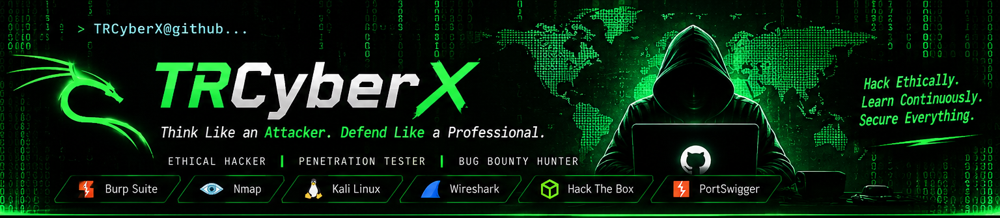

# 🛡️ Cybersecurity | Ethical Hacking | Bug Bounty

### Think Like an Attacker. Defend Like a Professional.

---

## 👨‍💻 About Me

Hello! I'm a cybersecurity enthusiast building practical skills in ethical hacking, web application security, and vulnerability research.

- 🔐 Learning penetration testing and defensive security.
- 🐛 Exploring web vulnerabilities in authorized labs.
- 🧪 Practicing with CTFs and hands-on security challenges.
- 📚 Documenting what I learn and building useful security projects.
- 🤝 Open to learning, collaboration, and responsible security discussions.

## ⚔️ Skills & Tools

**Security:**  

**Platforms & Languages:**  

## 🧩 Web Security Topics

- Cross-Site Scripting (XSS)
- SQL Injection (SQLi)
- Insecure Direct Object References (IDOR)
- Authentication and authorization flaws
- Security misconfigurations
- Business logic vulnerabilities

*I test only systems I own or have explicit permission to assess.*

## 🚀 Current Learning Mission

- Strengthen web application penetration-testing fundamentals.
- Complete hands-on labs on PortSwigger Web Security Academy.
- Improve vulnerability discovery, validation, and reporting.
- Build practical cybersecurity scripts and lab projects.
- Write clear, responsible vulnerability reports.

## 🛠️ Featured Projects

| Project | Description |
|---|---|
| Web Security Labs | Notes and safe demonstrations from authorized practice labs. |
| Bug Bounty Notes | Learning notes, testing methodology, and report-writing examples. |
| Security Tools | Small scripts and utilities created for learning and defensive testing. |

*Replace these example project names with links to your actual repositories.*

## 📊 GitHub Activity

Your contribution graph is displayed automatically on your GitHub profile. This README avoids username-dependent statistics widgets, so no GitHub username is required inside the file.

## 📫 Connect

- GitHub: 
- LinkedIn: https://www.linkedin.com/in/t-r-singh-at-uttarakhand
-1a2373227. 
- Email: trevo2192@gmail.com

---

### 🔐 Hack Ethically • Learn Continuously • Secure Everything

**Happy Hacking!**

